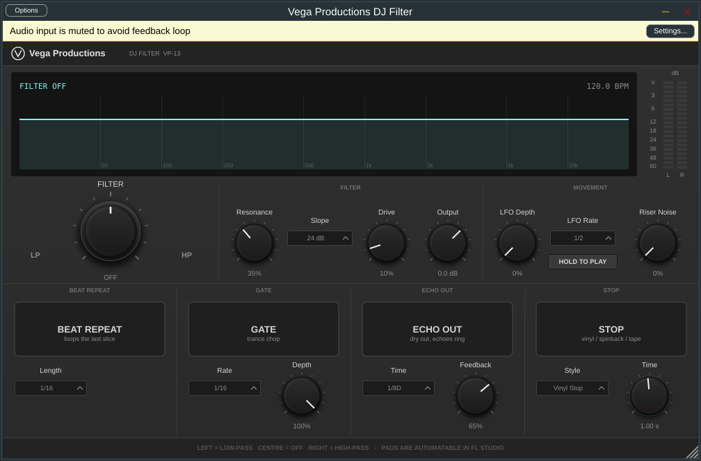

# Vega Productions DJ Filter (VP-13)

One-knob DJ filter plus performance FX for builds, drops and transitions.



## Download
- **Windows (FL Studio):** https://github.com/DJVega70/vega-djfilter/releases/latest/download/VegaProductions-DJFilter-Windows-VST3.zip
- **macOS:** https://github.com/DJVega70/vega-djfilter/releases/latest/download/VegaProductions-DJFilter-macOS-VST3-AU.zip

## Features
- **The big knob:** turn left for low-pass, right for high-pass, centre is a perfect bypass. Resonance, 12/24 dB slope, Drive, tempo-synced LFO wobble and a Riser Noise layer for build-ups.
- **Beat Repeat** — loops the last 1/32 to 1 bar instantly (seamless crossfaded loop).
- **Gate** — tempo-synced trance chop with depth.
- **Echo** — Pioneer DDJ/DJM-style Beat FX echo. The dry track keeps playing, and the echoes trail out in time after you switch the pad off. **BEAT** goes from 1/16 to 16 beats. **SYNC** locks the echo to the host tempo; turn SYNC off to set a free **TIME** from 1 to 4000 ms. **LEVEL/DEPTH** sets how loud the echoes are, **FEEDBACK** sets how many repeats you hear, and each repeat gets a little darker. Pull the channel fader down while it trails for the classic echo-out.
- **Stop** — Vinyl Stop, Spinback or Tape Stop with adjustable time.
- Pads latch (or switch to **HOLD TO PLAY**), and every pad is a parameter so you can automate it in FL Studio's playlist or map it to a controller.

## Building
```
cmake -B build -DVEGA_TESTS=ON
cmake --build build --config Release --target VegaDJFilter_VST3 VegaDJFilterTest
```
